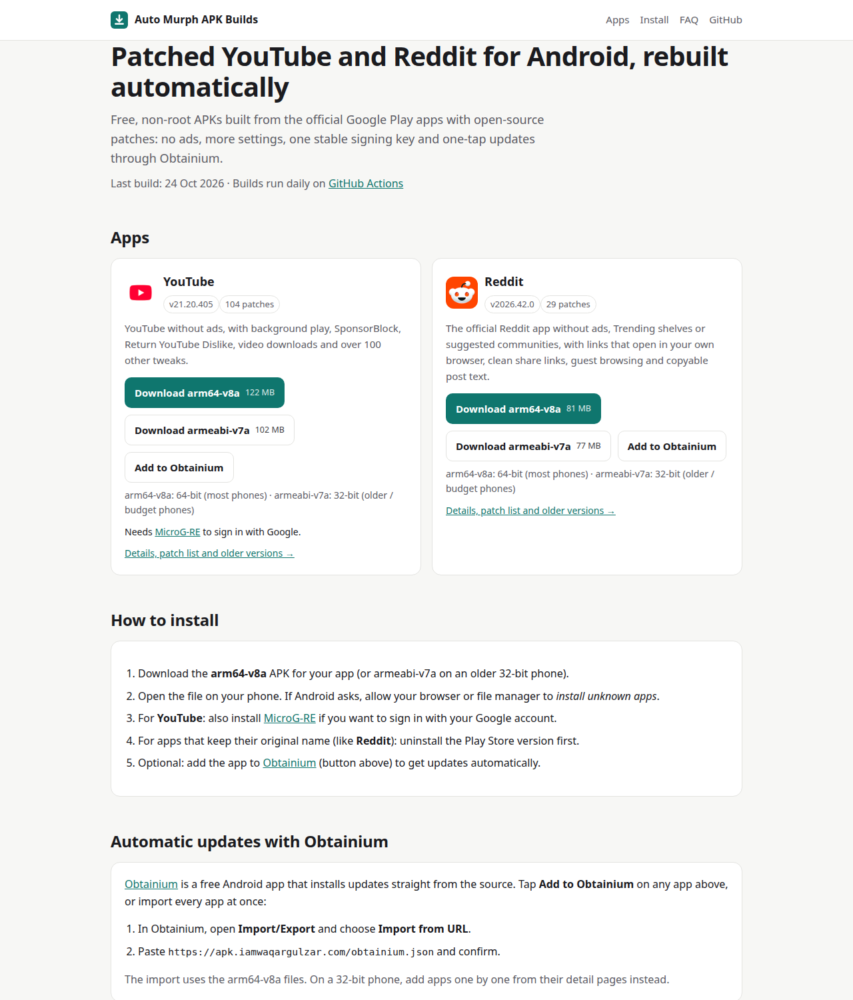
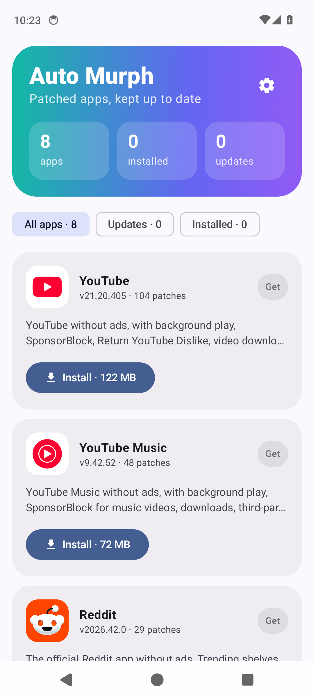
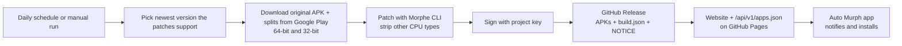
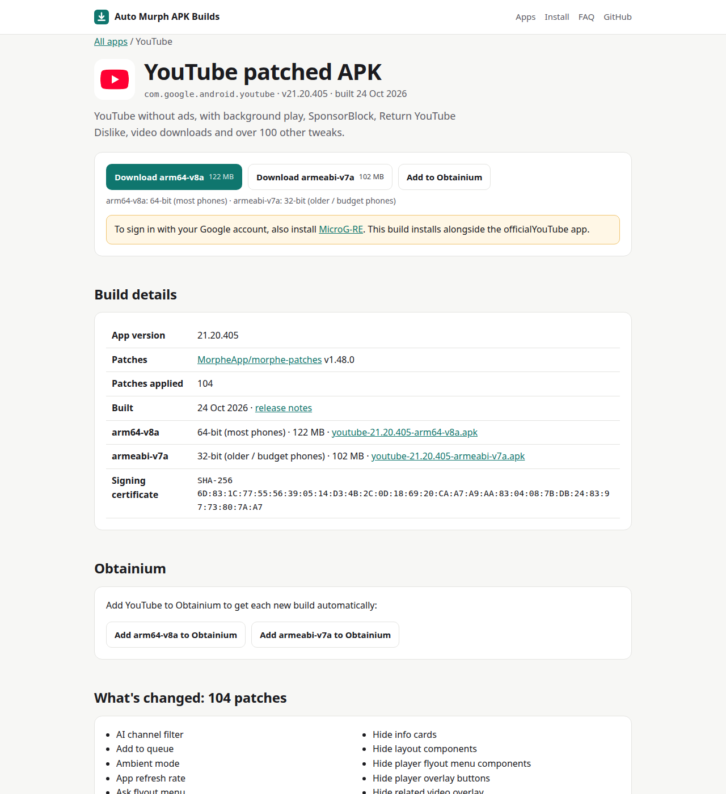
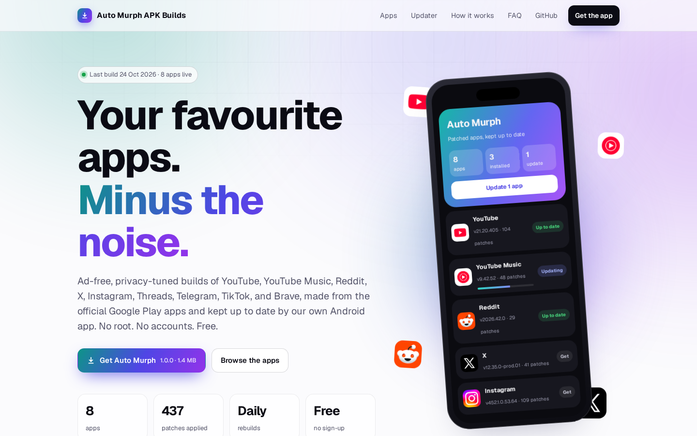
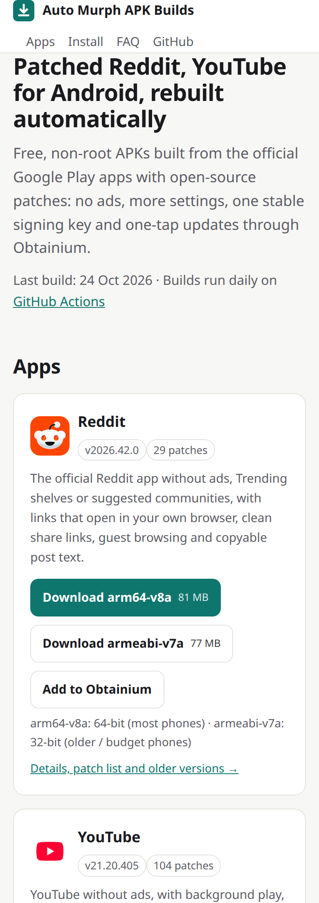

# Auto Murph APK Builds: ad-free YouTube, Instagram, X, Reddit, TikTok & more for Android

[](https://github.com/iamwaqargulzar/auto-murph-apk-builds/actions/workflows/build.yml)
[](https://github.com/iamwaqargulzar/auto-murph-apk-builds/releases?q=updater)
[](LICENSE)

**Auto Murph APK Builds** publishes free, non-root, patched Android apps (**YouTube, YouTube Music, Reddit, X,
Instagram, Threads, Telegram, TikTok** and **Brave**) and keeps them up to date with its own Android app,
**Auto Murph**. Every build starts from the official app on Google Play, applies open-source patches (no ads, less
clutter, privacy fixes, extra settings), is signed with one stable key and is published by GitHub Actions in public.

**Website: <https://apk.iamwaqargulzar.com>**: every app, the Auto Murph app, install guide and FAQ.



## Contents

- [Apps](#apps)
- [The Auto Murph app](#the-auto-murph-app)
- [Which APK do I need?](#which-apk-do-i-need)
- [How to install](#how-to-install)
- [Reddit login](#reddit-login)
- [Verify a download](#verify-a-download)
- [FAQ](#faq)
- [How it works](#how-it-works)
- [Run your own copy](#run-your-own-copy)
- [Request an app](#request-an-app)
- [License and disclaimer](#license-and-disclaimer)

## Apps

| App | What changes | Patches from | Install notes |
|---|---|---|---|
| [YouTube](https://apk.iamwaqargulzar.com/apps/youtube/) | No ads, background play, SponsorBlock, Return YouTube Dislike, downloads, 100+ options | [MorpheApp/morphe-patches](https://github.com/MorpheApp/morphe-patches) | Installs next to the official app; [MicroG-RE](https://github.com/MorpheApp/MicroG-RE/releases/latest) for Google sign-in |
| [YouTube Music](https://apk.iamwaqargulzar.com/apps/youtube-music/) | No ads, background play, SponsorBlock, downloads, lyrics, crossfade, Android Auto | [MorpheApp/morphe-patches](https://github.com/MorpheApp/morphe-patches) | Installs next to the official app; MicroG-RE for sign-in |
| [Reddit](https://apk.iamwaqargulzar.com/apps/reddit/) | No ads or Trending shelves, links open in your browser, clean share links, guest browsing | [MorpheApp/morphe-patches](https://github.com/MorpheApp/morphe-patches) | Uninstall the Play Store version first; see [Reddit login](#reddit-login) |
| [X](https://apk.iamwaqargulzar.com/apps/x/) | No ads, AI posts or "who to follow", classic Twitter branding, share posts as images | [crimera/piko-newx](https://github.com/crimera/piko-newx) | Uninstall the Play Store version first |
| [Instagram](https://apk.iamwaqargulzar.com/apps/instagram/) | No ads, suggested posts or Meta AI; reel/story downloads; read receipts and typing status you control | [SysAdminDoc/HushGram](https://github.com/SysAdminDoc/HushGram) | Uninstall the Play Store version first |
| [Threads](https://apk.iamwaqargulzar.com/apps/threads/) | No ads or suggested users, media saving, best image quality, pure black theme | [SysAdminDoc/HushThreads](https://github.com/SysAdminDoc/HushThreads) | Uninstall the Play Store version first |
| [Telegram](https://apk.iamwaqargulzar.com/apps/telegram/) | No sponsored messages or Premium/Stars promos, keep deleted messages, faster downloads | [SysAdminDoc/HushTelegram](https://github.com/SysAdminDoc/HushTelegram) | Uninstall the Play Store version first |
| [TikTok](https://apk.iamwaqargulzar.com/apps/tiktok/) | No feed ads or shopping clutter, tracker blocking, seek bar, links in your browser | [kveld9/kveld-morphe-patches](https://github.com/kveld9/kveld-morphe-patches) | Uninstall the Play Store version first |
| [Brave](https://apk.iamwaqargulzar.com/apps/brave/) | No sponsored start page or promo notifications, analytics off, less battery drain | [kveld9/kveld-morphe-patches](https://github.com/kveld9/kveld-morphe-patches) | Builds as soon as Google Play releases the version the patches support |

Patches that unlock **paid subscriptions** are left out (for example X Premium features and TikTok's watermark remover).
Current versions, patch lists, checksums and file sizes are on the [website](https://apk.iamwaqargulzar.com) and in
[Releases](https://github.com/iamwaqargulzar/auto-murph-apk-builds/releases).

## The Auto Murph app

Auto Murph is this project's own Android app for installing and updating the patched apps. It's open source
([`updater/`](updater)), under 2 MB, and signed with the same key as every build.



- **One-tap installs.** It picks the 64-bit or 32-bit file for your phone automatically.
- **Update alerts.** It checks every 6 hours and notifies you once per new build; it can be limited to Wi-Fi.
- **Verified downloads.** It checks each APK's SHA-256 checksum before installing, and matches installed apps to our certificate.
- **Spots conflicts.** If the Play Store version is installed, it explains why and offers to remove it.
- **Silent updates.** On Android 12+, apps it installed update without a confirmation prompt, and it updates itself.

**Get it:** download the latest `auto-murph-*.apk` from the
[updater releases](https://github.com/iamwaqargulzar/auto-murph-apk-builds/releases?q=updater) or the
[website](https://apk.iamwaqargulzar.com). It reads the public feed at
[`/api/v1/apps.json`](https://apk.iamwaqargulzar.com/api/v1/apps.json).

<br clear="right" />

## Which APK do I need?

Every app release has two files (Auto Murph chooses for you):

| File ends with | For | Example devices |
|---|---|---|
| `-arm64-v8a.apk` | 64-bit phones: almost every phone sold since about 2017 | Pixel, Galaxy S/A series, OnePlus, Xiaomi |
| `-armeabi-v7a.apk` | 32-bit phones: older or budget models | Galaxy J series, Android Go phones |

Not sure? Try `arm64-v8a` first. Android refuses to install the wrong one, so nothing breaks.

## How to install

1. Install **Auto Murph** (recommended), or download an APK from the [website](https://apk.iamwaqargulzar.com).
2. When Android asks, allow Auto Murph (or your browser) to **install unknown apps**.
3. **YouTube / YouTube Music:** install [MicroG-RE](https://github.com/MorpheApp/MicroG-RE/releases/latest) as well to sign in with Google.
   These install alongside the official apps.
4. **All other apps** keep their original package name: uninstall the Play Store version first. Android only updates an app
   with an APK signed by the same key.

## Reddit login

Logging in to **patched Reddit** often fails with "incorrect username or password" (even when it's right), and
**Google sign-in never works**. This affects every patched Reddit build, not just this one: Reddit checks Google Play
Integrity at login and modified apps fail it ([upstream issue](https://github.com/MorpheApp/morphe-patches/issues/1369)).

The workaround the patch maintainers recommend: log in with an **old version first, then update over it**. Your
session carries over.

1. Uninstall any Reddit app.
2. Install the **Reddit login helper** (patched Reddit 2024.02.0, from the
   [Reddit releases](https://github.com/iamwaqargulzar/auto-murph-apk-builds/releases?q=reddit-login)), and log in with
   your **email/username and password**.
3. Install the current patched Reddit over it (from Auto Murph or the website). You stay logged in.

If it still fails: try another network (Wi-Fi vs. mobile data, with or without a VPN) or wait 24–48 hours.

## Verify a download

All APKs, including Auto Murph, are signed with the same certificate:

```text
SHA-256: 6D:83:1C:77:55:56:39:05:14:D3:4B:2C:0D:18:69:20:CA:A7:A9:AA:83:04:08:7B:DB:24:83:97:73:80:7A:A7
```

```bash
apksigner verify --print-certs youtube-21.20.405-arm64-v8a.apk
```

Each release also has a `build.json` with the SHA-256 of every APK. If the fingerprint or checksum doesn't match, don't install the file.

## FAQ

**What is Auto Murph APK Builds?**
An open-source project that turns official Google Play apps into patched APKs and publishes them automatically, plus
the Auto Murph app that installs and updates them. Build scripts, logs and releases are all public in this repository.

**Is it free? Do I need root?**
Yes, it's free, and no root is needed.

**How often are builds updated?**
A build runs every day at 02:00 UTC. A new release appears when the patches or the newest supported app version change.
Auto Murph notifies you; you can also *Watch → Releases* on GitHub.

**Why is an app's version older than the Play Store one?**
Patches target specific app versions. Each build uses the newest version the current patches fully support.

**Why does YouTube need MicroG-RE?**
Patched YouTube and YouTube Music are signed with a different key, so Google Play Services won't sign them in.
MicroG-RE is a small open-source stand-in for Google sign-in. Without it they work signed out.

**Where do the original APKs come from?**
Directly from Google Play. No third-party APK mirrors are used.

**Is it safe?**
The source APK comes from Google Play, the patches are open source, every build runs with public logs, and every file is
signed with the same certificate. Auto Murph verifies checksums before installing.

**Is it legal?**
This isn't legal advice. The patches are GPLv3 and their notice ships with every release; the original apps are free.
Using a modified client may go against a service's terms of service, so decide for yourself.

**An app crashes or a feature is missing. What now?**
Check the release notes (patches that failed are listed). Open an [issue](https://github.com/iamwaqargulzar/auto-murph-apk-builds/issues)
with the app version and phone model. Problems inside a patch belong to the patch project linked in [Apps](#apps).

## How it works



- **Build tool:** TypeScript (Node 22+) in [`tool/`](tool). Each app is one YAML file in [`apps/`](apps); patch sources are in [`sources/`](sources).
- **Patcher:** [Morphe Desktop CLI](https://github.com/MorpheApp/morphe-desktop) on Java 21.
- **Google Play downloads:** [goopdl](https://github.com/Villoh/goopdl) with a dedicated Google account. Old versions are fetched by
  version code; codes come from the patch lists, Google Play and [`state/version-codes.json`](state/version-codes.json).
- **Website:** [Astro](https://astro.build) in [`site/`](site), on GitHub Pages at <https://apk.iamwaqargulzar.com>.
  It also serves [`/api/v1/apps.json`](https://apk.iamwaqargulzar.com/api/v1/apps.json), [`/sitemap.xml`](https://apk.iamwaqargulzar.com/sitemap.xml)
  and [`/llms.txt`](https://apk.iamwaqargulzar.com/llms.txt).
- **Auto Murph app:** Kotlin + Jetpack Compose in [`updater/`](updater), built and released by its own workflow.
- **Cost:** none. It's a public repository on standard GitHub-hosted runners, and APKs are release assets.

<details>
<summary>More screenshots</summary>

| App page | Light mode | Mobile |
|---|---|---|
|  |  |  |

</details>

## Run your own copy

1. Fork this repository and keep it **public** (Actions minutes are free for public repos).
2. Create a signing key once and **back it up**. Losing it means users must reinstall:
   ```bash
   keytool -genkeypair -storetype PKCS12 -keystore release.keystore -alias release \
     -keyalg RSA -keysize 4096 -validity 36500 -dname "CN=My APK Builds"
   ```
3. Add repository secrets: `KEYSTORE_B64` (`base64 -w0 release.keystore`), `KEYSTORE_PASSWORD`, `KEY_ALIAS`, `KEY_PASSWORD`.
4. Create a **separate** Google account for downloads and run `scripts/setup-play-token.sh` in your clone. It signs in through a
   browser window, tests the token and saves `GOOPDL_ACCOUNT_EMAIL` and `GOOPDL_AAS_TOKEN` as secrets without printing them.
5. Edit `PROJECT` in [`tool/config.ts`](tool/config.ts) and `FEED_URL` / `CERT_SHA256` in
   [`updater/app/build.gradle.kts`](updater/app/build.gradle.kts), enable GitHub Pages with "GitHub Actions" as the source,
   then run **Actions → Build → Run workflow**.

Local builds need Node 22+, Java 21, the Android SDK (for `aapt2`), [uv](https://docs.astral.sh/uv/) and `zip`:

```bash
npm ci
npm run apkb -- versions youtube        # versions the patches support
KEYSTORE_PATH=release.keystore KEYSTORE_PASSWORD=... KEY_ALIAS=... KEY_PASSWORD=... \
  npm run apkb -- build youtube --no-release
npm run site:build                      # website into dist/
(cd updater && ./gradlew :app:assembleRelease)
```

To add an app, copy a file in [`apps/`](apps), change `name`, `package` and `source`, and add a `sources/<name>.yml`
if the patches come from another repository. Use `exclude:` for patches you don't want.

## Request an app

[Open an app request](https://github.com/iamwaqargulzar/auto-murph-apk-builds/issues/new?template=request-app.yml) with the
app name and Play Store link. Apps are added when a maintained patch set supports them without unlocking paid features.

## License and disclaimer

- The build tooling, website and Auto Murph app in this repository are [MIT licensed](LICENSE).
- Released APKs contain code from third-party patches licensed under GPLv3; every release includes their [NOTICE](NOTICE).
  "Morphe" is the patch project's name; this project is independent of it.
- YouTube and Google Play are trademarks of Google LLC; Instagram and Threads of Meta Platforms, Inc.; X of X Corp.;
  Reddit of Reddit, Inc.; Telegram of Telegram FZ-LLC; TikTok of ByteDance Ltd.; Brave of Brave Software, Inc.
  This project is not affiliated with or endorsed by any of them.
