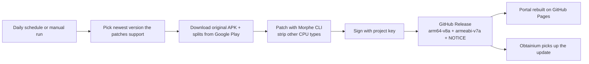
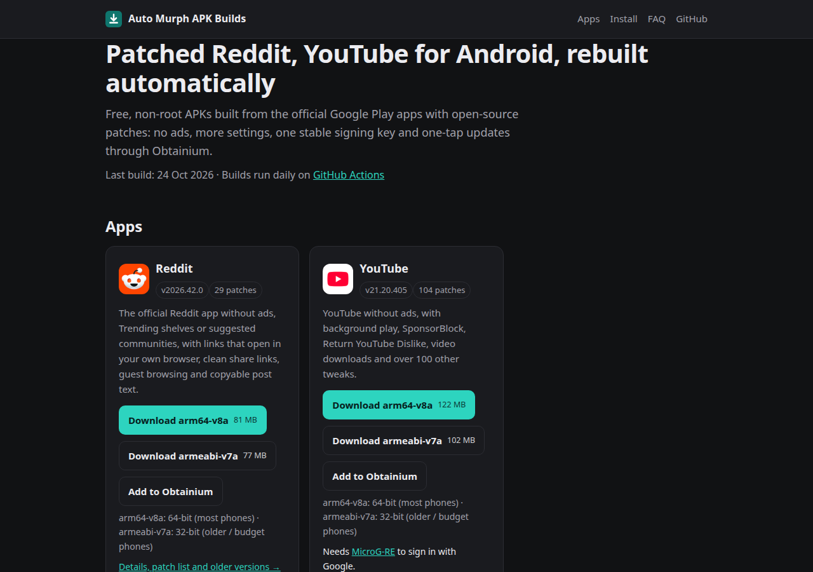

# Auto Murph APK Builds: patched YouTube and Reddit APKs for Android

[](https://github.com/iamwaqargulzar/auto-murph-apk-builds/actions/workflows/build.yml)
[](https://github.com/iamwaqargulzar/auto-murph-apk-builds/releases)
[](LICENSE)

**Auto Murph APK Builds** publishes free, non-root, patched Android APKs of **YouTube** and **Reddit**.
Every build starts from the official app on Google Play, applies open-source
[Morphe patches](https://github.com/MorpheApp/morphe-patches) (ad blocking, SponsorBlock, background play and
more), is signed with one stable key and is released here automatically by GitHub Actions.

**Download page: <https://apk.iamwaqargulzar.com>**: latest builds, install guide, FAQ and one-tap Obtainium setup.


## Contents

- [Apps](#apps)
- [Which APK do I need?](#which-apk-do-i-need)
- [How to install](#how-to-install)
- [Automatic updates with Obtainium](#automatic-updates-with-obtainium)
- [Verify a download](#verify-a-download)
- [FAQ](#faq)
- [How it works](#how-it-works)
- [Run your own copy](#run-your-own-copy)
- [Request an app](#request-an-app)
- [License and disclaimer](#license-and-disclaimer)

## Apps

| App | Package | Patches | What changes | Notes |
|---|---|---|---|---|
| [YouTube](https://apk.iamwaqargulzar.com/apps/youtube/) | `com.google.android.youtube` | [MorpheApp/morphe-patches](https://github.com/MorpheApp/morphe-patches) | No ads, background play, SponsorBlock, Return YouTube Dislike, downloads, 100+ options | Needs [MicroG-RE](https://github.com/MorpheApp/MicroG-RE/releases/latest) for Google sign-in; installs next to the official app |
| [Reddit](https://apk.iamwaqargulzar.com/apps/reddit/) | `com.reddit.frontpage` | [MorpheApp/morphe-patches](https://github.com/MorpheApp/morphe-patches) | No ads or Trending shelves, links open in your browser, clean share links, guest browsing | Uninstall the Play Store version first |

Current versions, patch counts and file sizes are on the [download page](https://apk.iamwaqargulzar.com) and in
[Releases](https://github.com/iamwaqargulzar/auto-murph-apk-builds/releases). Each release lists every applied patch.

## Which APK do I need?

Every release has two files:

| File ends with | For | Example devices |
|---|---|---|
| `-arm64-v8a.apk` | 64-bit phones: almost every phone sold since about 2017 | Pixel, Galaxy S/A series, OnePlus, Xiaomi |
| `-armeabi-v7a.apk` | 32-bit phones: older or budget models | Galaxy J series, Android Go phones |

Not sure? Try `arm64-v8a` first. Android refuses to install the wrong one, so nothing breaks.

## How to install

1. Download the APK for your app from the [download page](https://apk.iamwaqargulzar.com) or
   [Releases](https://github.com/iamwaqargulzar/auto-murph-apk-builds/releases).
2. Open it on your phone. If asked, allow your browser or file manager to **install unknown apps**.
3. **YouTube:** install [MicroG-RE](https://github.com/MorpheApp/MicroG-RE/releases/latest) as well if you want to sign in
   with your Google account. Patched YouTube installs alongside the official app.
4. **Reddit:** uninstall the Play Store version first. It uses the same package name, and Android only updates an app with an APK
   signed by the same key.
5. Optional: add the app to [Obtainium](#automatic-updates-with-obtainium) for automatic updates.

## Automatic updates with Obtainium

[Obtainium](https://obtainium.imranr.dev) installs updates straight from GitHub.

- **One app:** tap **Add to Obtainium** on the [download page](https://apk.iamwaqargulzar.com) (64-bit and 32-bit buttons are on each app's page).
- **All apps:** in Obtainium choose **Import/Export → Import from URL** and paste
  `https://apk.iamwaqargulzar.com/obtainium.json` (uses the arm64-v8a files).

Obtainium follows this repository's releases, picks your app by release title and your file by its CPU-type suffix.

## Verify a download

All APKs are signed with the same certificate:

```text
SHA-256: 6D:83:1C:77:55:56:39:05:14:D3:4B:2C:0D:18:69:20:CA:A7:A9:AA:83:04:08:7B:DB:24:83:97:73:80:7A:A7
```

Check a file before installing:

```bash
apksigner verify --print-certs youtube-21.20.405-arm64-v8a.apk
```

On Android, the free [App Manager](https://github.com/MuntashirAkon/AppManager) app shows the same fingerprint.
If it doesn't match, don't install the file.

## FAQ

**What is Auto Murph APK Builds?**
An open-source project that turns official Google Play apps into patched APKs with the Morphe patcher and publishes them
automatically. The build scripts, logs and releases are all public in this repository.

**Is it free? Do I need root?**
Yes, it's free, and no root is needed. The APKs install like any other app.

**How often are builds updated?**
A build runs every day at 02:00 UTC. A new release appears when the patches or the newest supported app version change.
You can follow new releases with Obtainium or GitHub's *Watch → Releases*.

**Why is the YouTube version older than the Play Store one?**
Patches are written for specific app versions. Each build uses the newest version the current patches fully support,
which is usually a few weeks behind Google Play.

**Why does YouTube need MicroG-RE?**
Patched YouTube is signed with a different key, so Google Play Services won't sign it in. MicroG-RE is a small
open-source stand-in that handles Google sign-in and notifications. Without it, YouTube works signed out.

**Where do the original APKs come from?**
Directly from Google Play, downloaded by the build with a dedicated account. No third-party APK mirrors are used.

**Is it safe?**
The source APK comes from Google Play, the patches are open source, and every build runs in public on GitHub Actions
with logs you can read. All files carry the same signing certificate (see [Verify a download](#verify-a-download)).
As with any modified app, use it with an account you are comfortable using it with.

**Is it legal?**
This isn't legal advice. The patches are GPLv3 and their notice ships with every release; the original apps are free.
Using a modified client may go against a service's terms of service, so decide for yourself.

**A patched app crashes or a feature is missing. What now?**
Check the release notes: failed patches are listed there. Open an
[issue](https://github.com/iamwaqargulzar/auto-murph-apk-builds/issues) with the app version and your phone model.
Problems in a patch itself belong to the patch project linked in the [Apps](#apps) table.

## How it works



- **Build tool:** TypeScript (Node 22+) in [`tool/`](tool). Each app is one YAML file in [`apps/`](apps); patch sources live in [`sources/`](sources).
- **Patcher:** [Morphe Desktop CLI](https://github.com/MorpheApp/morphe-desktop) on Java 21.
- **Google Play downloads:** [goopdl](https://github.com/Villoh/goopdl). Google Play serves older versions only by version code, so
  [`state/version-codes.json`](state/version-codes.json) maps version names to codes and grows with every build.
- **Portal:** [Astro](https://astro.build) static site in [`site/`](site), deployed to GitHub Pages at
  <https://apk.iamwaqargulzar.com>. It also serves [`/obtainium.json`](https://apk.iamwaqargulzar.com/obtainium.json),
  [`/sitemap.xml`](https://apk.iamwaqargulzar.com/sitemap.xml) and [`/llms.txt`](https://apk.iamwaqargulzar.com/llms.txt).
- **Cost:** none. It is a public repository on standard GitHub-hosted runners, and APKs are stored as release assets.

<details>
<summary>More screenshots</summary>

| App page | Mobile | Dark mode |
|---|---|---|
|  |  |  |

</details>

## Run your own copy

1. Fork this repository and keep it **public** (Actions minutes are free for public repos).
2. Create a signing key once and keep a backup. Losing it means users must reinstall:
   ```bash
   keytool -genkeypair -storetype PKCS12 -keystore release.keystore -alias release \
     -keyalg RSA -keysize 4096 -validity 36500 -dname "CN=My APK Builds"
   ```
3. Add repository secrets: `KEYSTORE_B64` (`base64 -w0 release.keystore`), `KEYSTORE_PASSWORD`, `KEY_ALIAS`, `KEY_PASSWORD`.
4. Create a **separate** Google account for downloads, then run `scripts/setup-play-token.sh` in your clone. It signs in through a
   browser window, tests the token and saves `GOOPDL_ACCOUNT_EMAIL` and `GOOPDL_AAS_TOKEN` as secrets without printing them.
5. Edit `PROJECT` in [`tool/config.ts`](tool/config.ts) (name, repo, site, certificate fingerprint), enable GitHub Pages with
   "GitHub Actions" as the source, then run **Actions → Build → Run workflow**.

Local builds need Node 22+, Java 21, [uv](https://docs.astral.sh/uv/) and `zip`:

```bash
npm ci
npm run apkb -- versions youtube        # versions the patches support
KEYSTORE_PATH=release.keystore KEYSTORE_PASSWORD=... KEY_ALIAS=... KEY_PASSWORD=... \
  npm run apkb -- build youtube --no-release
npm run site:build                      # portal into dist/
```

To add an app, copy [`apps/reddit.yml`](apps/reddit.yml), change `name`, `package` and `source`, and add a
`sources/<name>.yml` if the patches come from another repository.

## Request an app

[Open an app request](https://github.com/iamwaqargulzar/auto-murph-apk-builds/issues/new?template=request-app.yml) with the
app name and Play Store link. Apps are added when a maintained Morphe patch set supports them.

## License and disclaimer

- The build tooling and portal in this repository are [MIT licensed](LICENSE).
- Released APKs contain code from third-party patches licensed under GPLv3; every release includes their [NOTICE](NOTICE).
  "Morphe" is the patch project's name; this project is independent of it.
- YouTube is a trademark of Google LLC and Reddit is a trademark of Reddit, Inc. This project is not affiliated with or endorsed by them.
